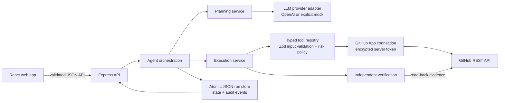

# LaunchPilot AI

LaunchPilot AI turns a developer goal into a structured, approval-gated plan, uses only typed tools against the chosen repository, inspects actual tool results, and reports verification evidence. Its differentiator is the full, inspectable loop: plan first, show exact write payloads, require approval, execute bounded GitHub actions, then verify by reading the resulting resource back.

## Product and Alexa+ track fit

LaunchPilot is a **text-based web-app simulation of an agentic developer productivity experience**. A developer asks for a repository readiness review; the agent plans and uses bounded GitHub tools; consequential changes remain under user approval. It is not an Alexa+ Skill, does not connect to an Alexa device, and does not use Amazon's gated Alexa+ add-on SDKs. The submission path is the hackathon's simulated Alexa+ experience option, and the demo must explicitly present the web app as the simulation. It should not be described as an official Alexa integration.

### Features

- Repository inspection, README and permitted text-file review, issues/PR lists and configurable readiness checks.
- Structured plan steps with server-assigned risk and GitHub permission requirements.
- Exact target and payload review with digest-bound approve/reject decisions before external writes.
- GitHub issue and documentation pull-request actions, with independent API read-back verification in live mode.
- Evidence timestamps, persisted audit events, safe error states, idempotent run creation and interrupted-run recovery.
- Explicit development mock mode that labels fixture results and never claims they came from GitHub.
- Persisted read-only runs that skip external-write steps server-side; external approval remains mandatory and cannot be disabled.
- Background run execution with live status polling, animated tool progress, and focused follow-up runs against the selected repository.
- Motion-based screen and dialog transitions, reduced-motion support, and browser-saved interface preferences.

### Architecture



### Technology

React 18, TypeScript, Vite, Tailwind CSS utilities plus the existing product stylesheet, Lucide icons, Node.js 20+, Express 5, Zod, the OpenAI JavaScript SDK's Responses API adapter, GitHub App user authorization and GitHub REST API. No Amazon SDK or API is used in the simulation implementation.

### Screenshots

> Screenshot placeholder: capture the real running app after selecting a safe test repository. Include one overview image and one approval/evidence image. Keep the mock/live mode label visible and do not use generated or altered output as proof of live execution.

## Run locally

Requirements: Node.js 20 or later.

```bash
npm ci
cp .env.example .env
npm run dev
```

PowerShell: `Copy-Item .env.example .env`. The frontend is served at `http://localhost:5173`; Express listens on `127.0.0.1:3001` and Vite proxies `/api`. Runs and the encrypted GitHub connection vault are stored under `DATA_DIR` (default `./data`). Do not commit `.env`, the `data` directory, GitHub secrets, or encryption keys.

With the checked-in environment defaults, the app runs with **explicit mock mode**. The app labels fixture results as simulated and makes no GitHub or model-provider requests. This is useful for exploring the interface and run lifecycle; it is not evidence that a real GitHub integration works.

## Configure a live GitHub App

LaunchPilot uses GitHub App user authorization. GitHub App user tokens are limited to the app's fine-grained repository permissions and the repositories the user grants access to. The authorization state is stored in a short-lived HttpOnly, SameSite cookie and checked on callback. Access and refresh tokens stay on the server, are encrypted with AES-256-GCM, and are never returned to the browser. Expiring user tokens are refreshed server-side. Disconnect attempts to revoke the GitHub App grant before deleting the encrypted local credential.

1. Register a GitHub App in GitHub Developer settings. Set its homepage to `http://localhost:5173/` and its user authorization callback URL to `http://localhost:5173/api/integrations/github/callback`.
2. Enable **User authorization (OAuth) during installation** / web application flow. Enable expiring user access tokens; LaunchPilot requests `offline_access` so it can refresh expiring credentials.
3. Configure the minimum repository permissions for the selected features:
   - **Metadata: Read-only** — list repositories and read repository metadata.
   - **Contents: Read-only** — inspect the repository tree and read README text.
   - **Issues: Read and write** — read issue lists; write is used only for a specifically approved issue action.
   - **Pull requests: Read-only** — inspect existing pull requests.
4. For the optional README branch + pull request action, additionally grant **Contents: Read and write** and **Pull requests: Read and write**. This broader write capability is disabled unless `GITHUB_APP_CONTENTS_WRITE=true`; every such action still waits for explicit approval. Never enable this unless the App has exactly these extra permissions and you want the feature.
5. Set `GITHUB_MODE=live`, `GITHUB_APP_CLIENT_ID`, `GITHUB_APP_CLIENT_SECRET`, `GITHUB_APP_CALLBACK_URL`, and `GITHUB_TOKEN_ENCRYPTION_KEY` in the server `.env`. For local development, the callback variable must exactly match the registered callback URL above. Restart the API, open **Integrations**, review the requested permissions, then select **Connect GitHub**. GitHub asks which repositories to authorize.

Generate a fresh AES-256 key without putting it in source control:

```powershell
[Convert]::ToBase64String([Security.Cryptography.RandomNumberGenerator]::GetBytes(32))
```

Paste the output into `GITHUB_TOKEN_ENCRYPTION_KEY`. Use a secret manager or protected environment secret in deployed environments. Losing this key makes the encrypted local connection unreadable; reconnect GitHub after rotating it. Use a different key per environment. Keep this prototype on loopback: it has a single-user credential vault and does not implement application user login or multi-tenant isolation.

### Environment variables

| Variable | Required | Purpose |
| --- | --- | --- |
| `NODE_ENV` | No | `development`, `test`, or `production`; defaults to `development`. |
| `PORT` | No | API port; defaults to `3001`. The server binds to loopback. |
| `DATA_DIR` | No | Run storage and encrypted GitHub credential location; defaults to `./data`. |
| `CORS_ORIGIN` | No | Comma-separated trusted frontend origins; defaults to `http://localhost:5173`. Write requests with a different browser Origin are rejected. |
| `REQUEST_TIMEOUT_MS` | No | GitHub/OpenAI request timeout; defaults to `20000`. |
| `RUN_RATE_LIMIT` | No | API requests per minute per IP; defaults to `30`. |
| `LLM_MODE` | No | `mock` (default) or `openai`. Mode is shown in the UI. |
| `OPENAI_API_KEY` | For `LLM_MODE=openai` | Server-only model key. Never use a `VITE_` variable. |
| `OPENAI_MODEL` | No | Responses API model with function calling and strict JSON Schema; defaults to `gpt-5.5`. |
| `GITHUB_MODE` | No | `mock` (default) or `live`. Mock mode makes no GitHub API requests. |
| `GITHUB_APP_CLIENT_ID` | For live mode | GitHub App Client ID (not App ID). |
| `GITHUB_APP_CLIENT_SECRET` | For live mode | GitHub App OAuth client secret. Server-side only. |
| `GITHUB_APP_CALLBACK_URL` | For live mode | Exact callback URL registered in the GitHub App. |
| `GITHUB_TOKEN_ENCRYPTION_KEY` | For live mode | Base64-encoded 32-byte AES-256 key used to encrypt the access and refresh token vault. |
| `GITHUB_APP_CONTENTS_WRITE` | Optional | Set to `true` only when both optional GitHub App write permissions are configured; enables approved README branch/PR actions. Defaults to `false`. |
| `GITHUB_READINESS_REQUIREMENTS` | No | Comma-separated readiness keys from `readme,setup,license,demo,contributing,codeofconduct,security,changelog`. Defaults to `readme,setup,license,demo,contributing`. |

GitHub API requests use the currently supported `X-GitHub-Api-Version: 2026-03-10` header, a named User-Agent, paginated repository/issue/PR reads, fixed `api.github.com` endpoints, bounded result sets, request timeouts, and actionable rate-limit/permission errors. Repository owner/name are schema-validated and each target is fetched through the connected token before a tool acts on it. Model output cannot provide raw API URLs or arbitrary paths. Text reads use a server-side file allowlist.

Issue creation has an explicit approval gate and a run-specific marker to detect retries after an uncertain result. README pull requests use a deterministic per-run branch, check for an existing pull request before writing, and are verified by fetching the resulting pull request. The agent never directly edits the default branch. An approved action is followed by an API read-back; tool generation alone is not counted as success.

The readiness tool inspects repository files and reports evidence for the configured criteria. It checks presence, not semantic quality: README content is separately returned for the model to review. Competitions can customize expected criteria with `GITHUB_READINESS_REQUIREMENTS`; criterion presence is not a universal claim that every repository needs the same files.

## API and architecture

The API runs under `/api`; see [server/openapi.yaml](server/openapi.yaml).

- `server/github/connection.ts` implements GitHub App user authorization, CSRF state validation, encrypted token persistence/refresh/revocation, repository listing, authenticated REST requests, and safe GitHub error mapping.
- `server/routes.ts` exposes integration connect/callback/disconnect/repository routes and validated agent run, approval, retry, event, and verification routes.
- `server/tools/registry.ts` owns typed tool schemas, risk/approval requirements, repository/file validation, GitHub reads/writes, timeouts, and result shaping.
- `server/services/` contains planning, execution, approval, orchestration, and verification. Read tools can inform plans; external writes cannot be invoked by the model and must pass the explicit approval endpoint.
- `server/provider/llm.ts` provides a labeled deterministic mock planner and the OpenAI Responses API function-calling adapter.
- `server/store.ts` persists run states and events atomically in JSON. It is single-process storage for local development, not a multi-instance database.
- `src/api.ts` and `src/App.tsx` connect the current dashboard, repository picker, project readiness inspection, approvals, results, and integration management to the API.

Routes include `GET /api/integrations`, `GET /api/integrations/github`, `GET /api/integrations/github/repositories`, `GET /api/integrations/github/connect`, `GET /api/integrations/github/callback`, `POST /api/integrations/github/disconnect`, and the `/api/runs` endpoints documented in OpenAPI.

## Checks

```bash
npm run test
npm run typecheck
npm run build
```

Tests cover planning, approval/rejection, read-only policy, retries/idempotency, cancellation, encrypted OAuth token storage, OAuth state validation, repository listing, disconnect/revocation, GitHub rate-limit/permission errors, tool argument validation, and HTTP origin validation. Run creation returns `202 Accepted`; poll `GET /api/runs/{id}` and use the events/verifications endpoints for progress and final evidence.

## Live integration acceptance status

The API workflow and token protocol are covered with deterministic HTTP stubs. No valid GitHub App credentials were available in this workspace, so a live account authorization, live repository inspection, approved issue creation, or GitHub read-back has **not** been demonstrated here. The UI reports connected account state only after OAuth success, and run status derives from actual API results; keep mock mode enabled until the GitHub App is configured and the real acceptance path is exercised.

## Approval, audit and recovery

Consequential GitHub actions are paused before execution. The server presents the exact repository, action input, proposed content and permission set, then computes a SHA-256 digest over that proposal. The approval API requires the presented digest and recomputes it at decision time and immediately before the tool call. A changed target or payload invalidates the old decision and returns the run to review. High-impact tools are blocked by default; no deletion or permission-management tools are registered.

Tool outputs are stored as structured run results and audit events contain output summaries with issue titles, file bodies and proposed document contents omitted. README text is discarded from the persisted tool result as soon as proposal preparation no longer needs it, retaining only a content digest and length. Approval previews and the draft required for a future approved pull request are retained in the local run store so users can review exactly what would be sent. Verification rows retain an evidence timestamp and selected structured resource fields; sensitive token-like fields and document bodies are filtered. Mock-mode checks are labeled **Inconclusive** and never count as GitHub verification.

GET/HEAD GitHub requests use at most three attempts with exponential delays and honor short server-provided retry timing. Writes are not automatically retried. Issue creation uses a run marker and documentation PR creation checks its deterministic branch/PR before retrying. The API supports an `Idempotency-Key` on run creation to return the same persisted run for a repeated request. On startup, an interrupted in-flight tool step is recorded as failed/partially completed; safe continuation rechecks the GitHub marker/branch before a write can repeat and asks for approval again.

The JSON store is atomic for a single process but does not provide cross-process transactions or an encrypted database. The application is a local single-user prototype, and audit retention is tied to the run store; delete `DATA_DIR/runs.json` to clear persisted run history. Cancelling an in-flight GitHub request is rejected while that request is active because an external write may have an ambiguous outcome; cancel is available before execution or while waiting for approval.

The repository is a local prototype without user login/multi-tenant isolation or an external secret manager. Do not deploy it publicly as-is.

## GitHub documentation

- [GitHub App user authorization web flow](https://docs.github.com/en/apps/creating-github-apps/writing-code-for-a-github-app/building-a-login-with-github-button-with-a-github-app)
- [GitHub App permission requirements](https://docs.github.com/en/rest/authentication/permissions-required-for-github-apps)
- [Refreshing GitHub App user access tokens](https://docs.github.com/en/apps/creating-github-apps/authenticating-with-a-github-app/refreshing-user-access-tokens)
- [Repository REST endpoints and pagination](https://docs.github.com/en/rest/repos/repos)
